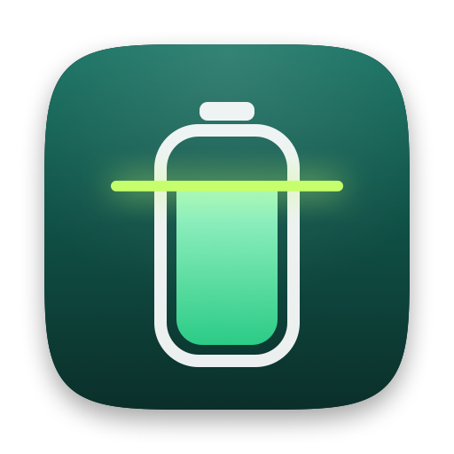

<p align="center">
  
</p>

<h1 align="center">Limiar</h1>

<p align="center">
  A charge limiter for Apple Silicon MacBooks that works on <b>macOS 27</b>.<br>
  Stop charging at the level you choose. The MagSafe light turns green while it's paused.
</p>

<p align="center">
  <a href="README.pt-BR.md">Leia em português</a>
</p>

---

## Why

Keeping a lithium battery near 100% for long periods ages it faster. macOS has a built-in charge limit, but on macOS 27 it often doesn't hold: the menu says "Will charge to 80%" and the Mac keeps charging. Tools that used to fix this (AlDente, batt, Battery Toolkit) stopped working because macOS 27 removed the SMC keys they relied on.

*Limiar* is Portuguese for *threshold*.

## Features

- **Charge range.** Stops charging at your limit (default 80%) and resumes at the level you pick (default 75%).
- **MagSafe light.** Green while Limiar is holding the charge, orange while charging, so you can tell at a glance.
- **Menu bar.** A battery icon in the same colour as the MagSafe light, with an optional percentage.
- **Charge to 100% once.** For a long trip. The limit comes back when you unplug.
- **Discharge while plugged in.** Run on battery down to a level you pick.
- **Sleep-aware.** It never overshoots while your Mac sleeps, even with the lid closed.
- **Fails safe.** If the service stops for any reason, normal charging is restored.
- English and Brazilian Portuguese.

## Requirements

- A MacBook with Apple Silicon
- macOS 26 or later. Built for macOS 27 and tested on a MacBook Air M4 (Mac16,12), macOS 27.2.1, firmware 20457.41.3

## Install

1. Download `Limiar-<version>.dmg` from [Releases](../../releases) and drag **Limiar** to Applications.
2. Limiar isn't notarized (that requires a paid Apple Developer account), so macOS blocks the first launch. Open it once, then go to **System Settings › Privacy & Security** and click **Open Anyway**. Or run:
   ```bash
   xattr -dr com.apple.quarantine /Applications/Limiar.app
   ```
3. Click **Turn On Charge Limit**, then switch on **Limiar** in System Settings › General › Login Items.

To uninstall: **Settings… › Background service › Remove…**, then move the app to the Trash.

## How it works

macOS 27 removed the SMC keys that charge limiters used to pause charging (`CHTE`, `CH0B`, `CH0C`). The firmware's own charge band (`bfD0`/`bfE0`/`bfF0`) is now locked behind a private Apple entitlement. One key still works: **`CHIE`**, which disconnects wall power from the system.

So Limiar doesn't pause charging. It cuts the power input:

| Battery | What Limiar does | MagSafe |
|---|---|---|
| reaches the limit | cuts wall power, so the Mac runs on battery | green |
| falls to the resume level | restores wall power and charging | orange |
| about to sleep near the limit | sleeps on battery (negligible drain) | green |
| about to sleep far below the limit | keeps charging and schedules a wake to check again | orange |

It has two parts:

- **`Limiar.app`**: a SwiftUI menu bar app.
- **`limiard`**: a small root daemon bundled inside the app, registered with `SMAppService`. It talks to the SMC and listens for power and sleep events. The app and daemon communicate over XPC.

The decision logic is a pure, unit-tested state machine in [`Sources/LimiarCore/ChargePolicy.swift`](Sources/LimiarCore/ChargePolicy.swift).

## Build from source

You need Xcode 26 or later.

```bash
git clone https://github.com/Jonorusc/limiar.git
cd limiar
make test       # unit tests
make install    # builds Limiar.app and copies it to /Applications
```

Other targets: `make app` (build only), `make icon` (re-render the icon), `make release` (zip and dmg).

## Troubleshooting

```bash
/Applications/Limiar.app/Contents/MacOS/limiard status   # current state
/Applications/Limiar.app/Contents/MacOS/limiard diag     # SMC keys and charger fields
sudo /Applications/Limiar.app/Contents/MacOS/limiard restore   # restore wall power now
log stream --predicate 'subsystem == "app.limiar"'
```

If Limiar doesn't work on your Mac, please [open an issue](../../issues/new/choose) and include the output of `limiard diag`.

## Security

The daemon runs as root because writing to the SMC requires it. It only accepts XPC connections from admin users whose code signature identifier is `app.limiar.Limiar`. Release builds are ad-hoc signed, so that identifier can be imitated by another local process. The worst such a process can do is change your charge limit.

## Credits

The research by [batt](https://github.com/charlie0129/batt) and [Battery Toolkit](https://github.com/mhaeuser/Battery-Toolkit) and its macOS 27 forks on Apple Silicon charging control made this possible.

## Website

The landing page lives in its own repository: [Jonorusc/limiar-lp](https://github.com/Jonorusc/limiar-lp).

## License

[MIT](LICENSE). Provided as is, without warranty: Limiar writes to your Mac's SMC. Use at your own risk.
