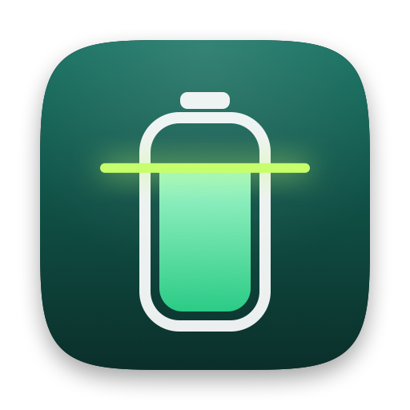

  

<h1 align="center">Limiar</h1>

  Limite de carga para MacBooks com Apple Silicon que funciona no <b>macOS 27</b>. 
  A carga para no nível que você escolher, e a luz do MagSafe fica verde enquanto está pausada.

<a href="README.md">Read in English</a>

---

## Por quê

Manter uma bateria de lítio perto de 100% por muito tempo acelera o desgaste. O macOS tem um limite de carga nativo, mas no macOS 27 ele muitas vezes não segura: o menu diz "Carregará até 80%" e o Mac continua carregando. Ferramentas como AlDente, batt e Battery Toolkit pararam de funcionar porque o macOS 27 removeu as chaves de SMC que elas usavam.

## Recursos

- **Faixa de carga:** para no limite (padrão 80%) e volta a carregar no nível que você escolher (padrão 75%).
- **Luz do MagSafe:** verde enquanto o Limiar segura a carga e laranja carregando.
- **Barra de menus:** ícone de bateria na mesma cor da luz do MagSafe, com a porcentagem opcional.
- **Carregar até 100% uma vez:** para uma viagem; o limite volta quando você desconectar.
- **Descarregar na tomada:** usa a bateria até o nível que você escolher.
- **Repouso:** não passa do limite com o Mac em repouso, nem com a tampa fechada.
- **Seguro em caso de falha:** se o serviço parar, a carga normal volta.
- Português e inglês.

## Instalar

1. Baixe o `Limiar-<version>.dmg` em [Releases](../../releases) e arraste o **Limiar** para Aplicativos.
2. O app não é notarizado (isso exige a conta paga de desenvolvedor da Apple). Na primeira vez, abra com **clique direito › Abrir**, ou rode `xattr -dr com.apple.quarantine /Applications/Limiar.app`.
3. Clique em **Ativar Limite de Carga** e ative o **Limiar** em Ajustes do Sistema › Geral › Itens de Início.

Para desinstalar: **Ajustes… › Serviço em segundo plano › Remover…**, depois mande o app para o Lixo.

## Como funciona

O macOS 27 removeu as chaves `CHTE`, `CH0B` e `CH0C` e bloqueou a faixa de carga do firmware (`bfD0`/`bfE0`/`bfF0`) com um entitlement privado da Apple. A chave **`CHIE`**, que corta a entrada da tomada, ainda funciona. Ao chegar no limite, o Limiar corta a tomada e o Mac passa a usar a bateria. Quando a bateria cai até o nível de retomada, a tomada volta. Detalhes técnicos, build e diagnóstico estão no [README em inglês](README.md).

## Licença

[MIT](LICENSE), fornecido "como está", sem garantia.
